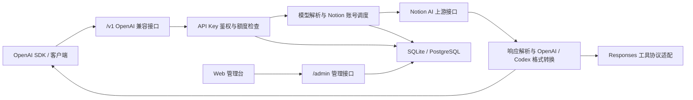

# Notion2API

[](https://go.dev/)
[](https://react.dev/)
[](https://www.postgresql.org/)
[](#api-用法)

Notion2API 是一个基于 Go 的 Notion AI OpenAI / Codex 兼容桥接服务。它把 Notion AI 的上游协议封装成常见的 `/v1/models`、`/v1/chat/completions`、`/v1/responses` 接口，并提供 Web 管理台用于维护 Notion 账号池、API Key、模型、请求日志和用量统计。

项目定位是私有化部署的 API 网关：客户端继续按 OpenAI 兼容格式调用，本服务负责鉴权、账号调度、Notion 会话请求、响应格式转换、Codex 工具协议适配和本地持久化。

> 适合个人或团队在自有环境中统一接入 Notion AI，并对调用入口、账号池、额度、日志和代理进行集中管理。

## 目录

- [功能特性](#功能特性)
- [工作原理](#工作原理)
- [技术栈](#技术栈)
- [快速开始](#快速开始)
- [首次配置流程](#首次配置流程)
- [接口一览](#接口一览)
- [API 用法](#api-用法)
- [管理台](#管理台)
- [配置说明](#配置说明)
- [项目结构](#项目结构)
- [开发与测试](#开发与测试)
- [生产部署建议](#生产部署建议)
- [路线图](#路线图)
- [贡献说明](#贡献说明)
- [常见问题](#常见问题)
- [风险与免责声明](#风险与免责声明)

## 功能特性

- OpenAI 兼容接口：模型列表、Chat Completions、Responses。
- 支持 `stream: true`，以 SSE 格式返回 OpenAI 风格的流式数据。
- Codex Responses 兼容：支持文件引用、常用本地工具调用协议和工具名透传。
- Notion 账号池管理：账号启停、激活账号、优先级、并发数、失败状态、账号测试。
- Notion 登录辅助：支持邮箱验证码登录，也支持手工导入 Cookie、`token_v2` 或探测结果 JSON。
- API Key 管理：创建、启用、禁用、删除、过期时间、总额度和每日额度。
- 用量与日志：按 API Key、模型、日期记录请求数、估算 token 和请求日志。
- 会话能力：支持 Notion 线程 ID 透传、粘性会话绑定、远端 Notion 会话列表和详情查看。
- 代理配置：支持关闭代理、环境变量代理、HTTP、HTTPS、SOCKS5，并可按账号覆盖。
- 数据库存储：默认 SQLite，可通过配置切换 PostgreSQL。
- 前后端分离管理台：Go + Gin + GORM 后端，React + Vite + Ant Design 前端，Docker Compose 可同时启动后端和管理台。

## 工作原理



## 技术栈

### 后端

- Go
- Gin
- GORM
- SQLite / PostgreSQL
- Server-Sent Events

### 前端

- React
- Vite
- TypeScript
- Ant Design

### 部署

- Docker
- Docker Compose
- Nginx 前端静态服务与反向代理

## 快速开始

以下命令默认在项目根目录执行。

### 方式一：本地开发运行

后端示例配置当前监听 `127.0.0.1:9998`：

```bash
cd backend
go run ./cmd/server --config ./configs/config.example.yaml
```

启动后可以检查健康状态：

```bash
curl http://127.0.0.1:9998/healthz
```

另开一个终端，在项目根目录启动管理台：

```bash
cd frontend
pnpm install
VITE_API_BASE_URL=http://127.0.0.1:9998 pnpm dev
```

访问：

- 管理台：`http://127.0.0.1:5173/admin`
- 默认管理员：`admin`
- 示例配置默认密码：`change-me-please`
- 示例配置默认 API Key：`<api_key>`

首次运行后请立即修改管理员密码，并重新创建自己的 API Key。

### 方式二：Docker Compose

Docker Compose 默认同时启动后端和管理台前端：

- 后端 API：宿主机 `9998` -> 容器 `9998`
- 前端管理台：宿主机 `8080` -> Nginx 容器 `80`
- 前端容器会把 `/api/*` 反向代理到后端 `backend:9998`
- 默认使用 SQLite，并把运行数据持久化到挂载的数据目录。

```bash
N2A_BOOTSTRAP_ADMIN_USERNAME=admin \
N2A_BOOTSTRAP_ADMIN_PASSWORD=change-me-please \
N2A_BOOTSTRAP_API_KEY=sk-your-bootstrap-key \
docker compose up -d --build
```

检查服务：

```bash
curl http://127.0.0.1:9998/healthz
```

打开管理台：

```bash
http://127.0.0.1:8080/admin
```

如果需要 PostgreSQL：

```bash
docker compose --profile postgres up -d postgres

N2A_DATABASE_DRIVER=postgres \
N2A_DATABASE_DSN='host=postgres user=notion2api password=change-me dbname=notion2api port=5432 sslmode=disable TimeZone=Asia/Shanghai' \
docker compose up -d --build backend
```

### 方式三：仅构建镜像

```bash
docker build -t notion2api:latest .
```

运行时请根据实际环境挂载配置文件或通过环境变量覆盖配置。

## 首次配置流程

1. 登录管理台。
2. 在账号管理中添加 Notion 账号：
   - 使用邮箱验证码登录；或
   - 手工导入 `cookie_header` / `token_v2` / probe JSON。
3. 选择一个可用账号并激活。
4. 在 API Key 页面创建或确认可用 Key。
5. 使用 OpenAI 兼容客户端调用 `/v1/*` 接口。

如果账号没有配置 `auth_token` 或 Cookie，服务只会完成请求转换并跳过真实 Notion 上游调用，适合调试转换结果，但不会得到真实 Notion AI 回复。

## 接口一览

### 公开接口

| 方法 | 路径 | 鉴权 | 说明 |
| --- | --- | --- | --- |
| `GET` | `/` | 否 | 服务入口信息。 |
| `GET` | `/healthz` | 否 | 健康检查。 |
| `GET` | `/v1/models` | API Key | OpenAI 兼容模型列表。 |
| `GET` | `/v1/models/:id` | API Key | 查询单个模型。 |
| `POST` | `/v1/chat/completions` | API Key | OpenAI Chat Completions。 |
| `POST` | `/v1/responses` | API Key | OpenAI Responses。 |
| `GET` | `/v1/responses/:id` | API Key | 响应查询接口；如未启用响应持久化，可能返回未实现或未找到。 |

### 管理接口

| 模块 | 路径 | 说明 |
| --- | --- | --- |
| 登录 | `/admin/login`、`/admin/logout`、`/admin/verify` | 管理员登录、退出和 token 校验。 |
| 管理员 | `/admin/admins` | 管理员列表、新增、更新和删除。 |
| API Key | `/admin/api-keys` | API Key 创建、启停、删除、额度和单 Key 用量。 |
| 账号 | `/admin/accounts` | Notion 账号新增、导入、登录、工作区/空间、激活、测试和代理配置。 |
| 模型 | `/admin/models` | 查看公开模型、启停状态和 Notion 内部模型映射。 |
| 会话 | `/admin/notion-conversations` | Notion 远端 AI 会话列表、详情和删除。 |
| 用量日志 | `/admin/usage`、`/admin/logs` | token 估算用量和请求日志。 |

管理接口除 `/admin/login` 外，都支持通过 `X-Admin-Token`、`Authorization: Bearer <token>` 或登录 Cookie 鉴权。

## API 用法

所有 `/v1/*` 接口都需要：

```http
Authorization: Bearer <api_key>
```

### 查看模型

```bash
curl http://127.0.0.1:9998/v1/models \
  -H 'Authorization: Bearer <api_key>'
```

### Chat Completions

```bash
curl http://127.0.0.1:9998/v1/chat/completions \
  -H 'Authorization: Bearer <api_key>' \
  -H 'Content-Type: application/json' \
  -d '{
    "model": "auto",
    "messages": [
      {"role": "system", "content": "你是一个简洁的中文助手。"},
      {"role": "user", "content": "用一句话介绍 Notion2API。"}
    ],
    "use_web_search": false
  }'
```

### 流式响应

```bash
curl -N http://127.0.0.1:9998/v1/chat/completions \
  -H 'Authorization: Bearer <api_key>' \
  -H 'Content-Type: application/json' \
  -d '{
    "model": "auto",
    "stream": true,
    "messages": [
      {"role": "user", "content": "写一个三点清单。"}
    ]
  }'
```

### Responses

```bash
curl http://127.0.0.1:9998/v1/responses \
  -H 'Authorization: Bearer <api_key>' \
  -H 'Content-Type: application/json' \
  -d '{
    "model": "auto",
    "input": "把这句话翻译成英文：今天适合写文档。"
  }'
```

### Codex Responses 兼容

Codex 原生 Responses 请求会在本地兼容以下能力：

- `@README.md` / `@path/file` 形式的文件引用。
- `exec_command` 文件读取类工具调用。
- `apply_patch` 自定义工具调用；工具名带命名空间时也会按客户端声明名返回，便于兼容不同客户端的工具声明方式。
- 常见 `input` / `output` item 的格式转换。
- 工具调用结果回传与上游响应合并。

### 兼容客户端配置

大多数支持 OpenAI 兼容接口的客户端只需要改 Base URL 和 API Key：

| 配置项 | 本地开发示例 | Docker 示例 |
| --- | --- | --- |
| Base URL | `http://127.0.0.1:9998/v1` | `http://127.0.0.1:9998/v1` |
| API Key | `<api_key>` | 你的 `N2A_BOOTSTRAP_API_KEY` 或管理台创建的 Key |
| Model | `auto` | `auto` 或 `/v1/models` 返回的模型 ID |

调用失败时优先检查：后端端口、API Key 状态、Notion 账号是否已激活、账号是否有有效 Cookie / `token_v2`。

### 常用扩展字段

| 字段 | 说明 |
| --- | --- |
| `account_email` / `notion_account_email` | 指定使用某个 Notion 账号。 |
| `thread_id` / `notion_thread_id` | 复用指定 Notion 线程；开启粘性会话后会绑定到同一账号。 |
| `conversation_id` | 透传或复用上游会话标识。 |
| `use_web_search` | 覆盖配置中的 Web Search 开关。 |
| `metadata.use_web_search` | 也可通过 metadata 控制 Web Search。 |
| `response_format` | 会被转换为隐藏提示，约束输出格式。 |

未被识别的 OpenAI 扩展字段通常会被忽略或透传到内部转换层；是否生效取决于当前上游 Notion AI 协议和模型能力。

## 管理台

管理台挂载在 `/admin` 路由下，前端开发服务默认访问 `http://127.0.0.1:5173/admin`。

主要页面：

- 仪表盘：服务状态、关键统计。
- 管理员：管理员账号创建、更新、启停。
- API Keys：创建和管理可分发 API Key，查看额度和用量。
- 账号池：Notion 账号登录、手工导入、激活、测试、空间查看。
- 模型：查看当前公开模型和对应 Notion 内部模型。
- 会话：读取和删除 Notion 远端 AI 会话。
- 请求测试：在管理台内发起测试请求。
- 请求日志和用量：查看调用记录、耗时和 token 估算。

## 配置说明

配置文件位于：

- 本地开发：`backend/configs/config.example.yaml`
- Docker：`backend/configs/config.docker.yaml`

常用配置：

```yaml
server:
  host: 127.0.0.1
  port: 9998

security:
  admin_token_ttl_hours: 24
  bootstrap_admin:
    username: admin
    password: change-me-please
  bootstrap_api_key: "<api_key>"

database:
  driver: sqlite
  dsn: data/notion2api.sqlite

upstream:
  base_url: https://www.notion.so
  origin: https://www.notion.so
  timeout_seconds: 180

proxy:
  mode: off
  url: ""

sticky:
  enabled: true
  ttl_seconds: 604800
```

支持的环境变量覆盖：

| 变量 | 说明 |
| --- | --- |
| `N2A_SERVER_HOST` / `N2A_SERVER_PORT` | 服务监听地址和端口。 |
| `N2A_BOOTSTRAP_ADMIN_USERNAME` / `N2A_BOOTSTRAP_ADMIN_PASSWORD` | 首次初始化管理员。 |
| `N2A_BOOTSTRAP_API_KEY` | 首次初始化 API Key；为空则不自动创建。 |
| `N2A_ADMIN_TOKEN_TTL_HOURS` | 管理员登录 token 有效期。 |
| `N2A_DATABASE_DRIVER` / `N2A_DATABASE_DSN` | 数据库类型和连接串。 |
| `N2A_PROXY_MODE` / `N2A_PROXY_URL` | 全局上游代理。 |
| `N2A_PROXY_HTTP_URL` / `N2A_PROXY_HTTPS_URL` | 分协议代理地址。 |
| `N2A_STICKY_ENABLED` / `N2A_STICKY_TTL_SECONDS` | 粘性会话开关和有效期。 |
| `N2A_STICKY_REDIS_URL` | 可选 Redis 粘性会话存储。 |
| `N2A_LOGIN_HELPER_SESSIONS_DIR` | Notion 登录会话文件目录。 |
| `N2A_LOGIN_HELPER_TIMEOUT_SEC` | 邮箱验证码登录有效期。 |
| `VITE_API_BASE_URL` | 前端开发服务访问后端 API 的基础地址。 |

代理模式：

- `off`：关闭代理。
- `env`：读取 `HTTP_PROXY`、`HTTPS_PROXY`、`ALL_PROXY` 等环境变量。
- `http`：固定 HTTP 代理。
- `https`：按 HTTP / HTTPS 分别指定代理。
- `socks5`：SOCKS5 代理。

账号级代理会覆盖全局代理配置，适合多账号分流。

### 配置优先级

通常建议按以下顺序管理配置：

1. 默认配置文件。
2. Docker Compose 或运行环境中的环境变量。
3. 管理台中可维护的运行时数据，例如账号、API Key、模型启停和代理覆盖。

生产环境不要直接使用示例密码、示例 API Key 或默认 SQLite 文件路径。

## 项目结构

```text
notion2api/
├── backend/
│   ├── cmd/server/              # 后端入口
│   ├── configs/                 # YAML 配置
│   └── internal/
│       ├── bootstrap/           # 启动装配
│       ├── config/              # 配置加载与环境变量覆盖
│       ├── router/              # Gin 路由
│       ├── middleware/          # 鉴权、日志、CORS
│       ├── handler/             # HTTP Handler
│       ├── service/             # 业务逻辑、Notion 网关、账号调度
│       ├── repository/          # GORM 数据访问
│       ├── model/               # 数据模型
│       ├── dto/                 # 请求响应结构
│       ├── proxy/               # 上游代理客户端
│       └── pkg/                 # 项目内工具
├── frontend/
│   └── src/
│       ├── app/                 # React Router 与 Provider
│       ├── layouts/             # 管理台布局
│       ├── pages/               # 管理台页面
│       ├── services/            # API Client
│       ├── types/               # 前端类型
│       └── styles/              # 全局样式
├── docs/                        # 补充文档
├── Dockerfile
└── docker-compose.yml
```

## 开发与测试

后端：

```bash
cd backend
go test ./...
go run ./cmd/server --config ./configs/config.example.yaml
```

前端：

```bash
cd frontend
pnpm install
pnpm typecheck
pnpm build
```

如使用 npm，也可以执行 `npm install`、`npm run typecheck`、`npm run build`。

建议提交前至少执行：

```bash
cd backend
go test ./...

cd ../frontend
pnpm typecheck
pnpm build
```

## 生产部署建议

生产环境建议重点关注以下事项：

### 账号与密钥

- 不要使用示例管理员密码 `change-me-please`。
- 不要在公开仓库提交真实 `token_v2`、Cookie、API Key 或管理员 Token。
- 首次启动后立即修改管理员密码。
- 为不同调用方创建不同 API Key，便于额度控制和审计。
- 定期轮换 API Key 和 Notion 账号凭据。

### 网络与代理

- 推荐将服务部署在可信内网或通过反向代理暴露。
- 对外暴露时建议启用 HTTPS。
- 如果 Notion 上游访问不稳定，可配置全局代理或账号级代理。
- 多账号场景下可以使用账号级代理做出口隔离。

### 数据库

- 轻量部署可使用 SQLite。
- 多实例、高并发或长期生产使用建议切换 PostgreSQL。
- 定期备份数据库文件或 PostgreSQL 数据。
- SQLite 部署时请确保数据目录已持久化挂载。

### 日志与审计

- 根据实际隐私要求配置请求日志保留策略。
- 避免在日志中长期保存敏感业务内容。
- 关注失败率、耗时、账号状态和额度消耗。

### 多实例部署

如果需要多实例部署：

- 建议使用 PostgreSQL 作为共享数据库。
- 如启用粘性会话，建议使用 Redis 存储粘性绑定。
- 反向代理层应合理配置超时时间，避免流式响应被提前中断。

## 路线图

- [ ] 更完善的 Responses 持久化与查询能力。
- [ ] 更细粒度的模型映射配置。
- [ ] 更完善的账号健康检查和自动熔断策略。
- [ ] 更丰富的用量报表和导出能力。
- [ ] 支持更多 OpenAI 兼容客户端的边缘字段。
- [ ] 提供更完整的部署示例和迁移文档。

## 贡献说明

欢迎提交 Issue 和 Pull Request。

建议贡献流程：

1. Fork 本仓库。
2. 创建功能分支。
3. 完成代码、测试和文档更新。
4. 提交 Pull Request，并说明变更动机、主要实现和验证方式。

提交前请尽量保证：

- 后端测试通过：`go test ./...`
- 前端类型检查通过：`pnpm typecheck`
- 前端构建通过：`pnpm build`
- README 或 docs 已同步更新相关用法变化。

## 常见问题

### 1. 调用 `/v1/chat/completions` 没有真实 Notion AI 回复？

请检查管理台中是否已有可用 Notion 账号，并确认账号已激活且 Cookie / `token_v2` 有效。

如果账号没有配置有效凭据，服务可能只能完成本地请求转换，无法真正请求 Notion AI 上游。

### 2. 为什么返回 401？

通常是 API Key 缺失、已禁用、已过期或额度不足。请检查请求头：

```http
Authorization: Bearer <api_key>
```

并在管理台确认该 Key 状态正常。

### 3. Docker Compose 启动后打不开管理台？

请检查：

- 前端端口是否为 `8080`。
- 后端是否通过 `http://127.0.0.1:9998/healthz` 正常响应。
- 容器是否正常运行：`docker compose ps`。
- 前端 Nginx 是否能反向代理 `/api/*` 到后端容器。

### 4. 如何切换到 PostgreSQL？

启动 PostgreSQL profile，并设置：

```bash
N2A_DATABASE_DRIVER=postgres
N2A_DATABASE_DSN='host=postgres user=notion2api password=change-me dbname=notion2api port=5432 sslmode=disable TimeZone=Asia/Shanghai'
```

然后重新启动后端服务。

### 5. 流式响应中断怎么办？

请检查反向代理、网关或客户端的超时配置。流式响应需要较长连接时间，生产环境建议调大 read timeout / proxy timeout。

### 6. 可以直接把服务暴露到公网吗？

不建议裸露部署。至少应配置：

- HTTPS
- 强管理员密码
- 独立 API Key
- 访问控制或反向代理鉴权
- 日志与备份策略

## 风险与免责声明

本项目用于学习、研究和自托管集成场景。使用前请自行确认是否符合 Notion 及相关服务的使用条款。

请注意：

- Notion 上游协议可能变化，可能导致部分功能失效。
- Cookie、`token_v2`、API Key 属于敏感凭据，请妥善保管。
- 不建议将真实凭据提交到公开仓库、镜像或日志系统。
- 使用本项目产生的账号风险、数据风险和合规风险由使用者自行承担。

## License

请根据仓库实际许可证补充本节内容。

- 修改默认管理员密码，不要使用示例密码。
- 使用管理台创建正式 API Key，不要长期使用 bootstrap Key。
- 将 `data/` 挂载到持久化磁盘，并做好备份。
- 通过反向代理暴露服务时启用 HTTPS。
- 限制 `/admin` 访问来源，必要时加一层 IP 白名单或额外认证。
- 定期检查 Notion 账号登录态、失败次数和上游错误。
- 准备开源或公开部署前，不要提交数据库、Cookie、token、日志和本地会话文件。

## 路线图

- 完善 `/v1/responses/:id` 响应查询、响应持久化和 TTL 清理。
- 持续增强 Codex Responses 工具协议兼容性。
- 增强模型管理能力，支持后台启停和调整模型映射。
- 补充更多账号调度、粘性会话和 Notion 网关测试。
- 增加更细粒度的运行指标、错误审计和部署示例。

## 贡献说明

欢迎提交 Issue 和 Pull Request。建议贡献前先确认：

- 变更范围聚焦，避免无关格式化。
- 不提交真实 Notion Cookie、`token_v2`、API Key、数据库和日志。
- 后端变更尽量运行 `go test ./...`。
- 前端变更尽量运行 `pnpm typecheck` 和 `pnpm build`。
- 新增配置、接口或部署方式时同步更新 README 或 `docs/`。

## 常见问题

### 管理台请求失败

确认前端 `VITE_API_BASE_URL` 指向后端地址。本地示例配置和 Docker 默认地址都是 `http://127.0.0.1:9998`。

### `/v1/*` 返回 401

检查请求头是否包含 `Authorization: Bearer <api_key>`，并确认 API Key 未禁用、未过期、未超出额度。

### 上游返回 403 或账号不可用

Notion 登录态可能过期，或账号空间信息不完整。到管理台账号页面重新登录、手工导入 Cookie，或执行账号测试查看错误。

### 响应里显示 converted successfully

这通常表示账号缺少 `auth_token` 或 Cookie，服务只完成了 Notion 请求 payload 转换，没有真正调用上游。

### PostgreSQL 连接失败

确认 `database.driver=postgres`，并检查 DSN 中的 host、port、user、password、dbname 是否与实际 PostgreSQL 服务一致。

## 风险与免责声明

本项目依赖 Notion 的非官方 Web 接口，接口字段、鉴权方式和风控策略可能随 Notion 更新而变化。请仅在你有权使用的账号和空间内使用本项目，并自行承担账号安全、数据安全、调用频率和服务可用性风险。

## 开源协议

当前仓库尚未包含 `LICENSE` 文件。正式开源前建议补充明确的开源协议，例如 MIT 或 Apache-2.0。
